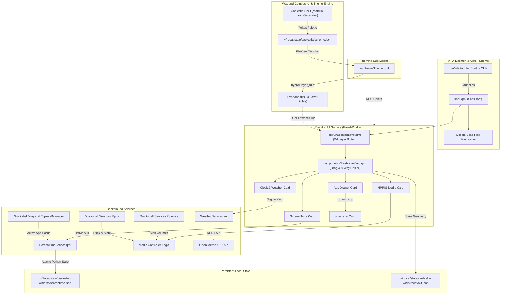

# WIDGETS FOR ALL
(Caelestia Desktop Widgets)

# 


<div align="center">

[](https://archlinux.org)
[](https://hyprland.org)
[](https://github.com/caelestia-dots)
[](https://quickshell.outfoxxed.me)
[](LICENSE)


*A modular, wallpaper-aware desktop widget system built with Qt 6 QML and Quickshell for Arch Linux, Hyprland, and Caelestia Shell.*


</div>

---

## Table of Contents

- [Overview & Identity](#overview--identity)
- [Key Features](#key-features)
  - [1. Wayland Layer Shell Surface & Input Masking](#1-wayland-layer-shell-surface--input-masking)
  - [2. Dynamic Caelestia & Material Design 3 Theming](#2-dynamic-caelestia--material-design-3-theming)
  - [3. Clock & Live Weather Dashboard](#3-clock--live-weather-dashboard)
  - [4. Multi-Source MPRIS & PipeWire Media Engine](#4-multi-source-mpris--pipewire-media-engine)
  - [5. Native Screen-Time Tracker](#5-native-screen-time-tracker)
  - [6. Responsive Application Drawer](#6-responsive-application-drawer)
  - [7. Freeform Drag-to-Move & 8-Way Resizing](#7-freeform-drag-to-move--8-way-resizing)
- [System Architecture](#system-architecture)
  - [Architecture Diagram](#architecture-diagram)
  - [Subsystem Responsibilities](#subsystem-responsibilities)
  - [Repository Layout](#repository-layout)
- [Prerequisites & Dependencies](#prerequisites--dependencies)
- [Installation & Setup](#installation--setup)
  - [1. Clone Repository](#1-clone-repository)
  - [2. Install CLI Daemon](#2-install-cli-daemon)
  - [3. Configure Hyprland Integration](#3-configure-hyprland-integration)
  - [4. Verify & Launch](#4-verify--launch)
- [Keybindings & Pointer Controls](#keybindings--pointer-controls)
  - [Keyboard Shortcuts](#keyboard-shortcuts)
  - [Mouse & Pointer Gestures](#mouse--pointer-gestures)
- [Configuration & Customization](#configuration--customization)
  - [Persistent Layout (`layout.json`)](#persistent-layout-layoutjson)
  - [Screen-Time Storage (`screentime.json`)](#screen-time-storage-screentimejson)
  - [Caelestia Color Scheme (`scheme.json`)](#caelestia-color-scheme-schemejson)
  - [Hyprland Compositor Blur Rules](#hyprland-compositor-blur-rules)
- [Data Storage, Privacy & Security](#data-storage-privacy--security)
- [Troubleshooting & Diagnostics](#troubleshooting--diagnostics)
- [Development Workflow](#development-workflow)
- [Roadmap & Project Status](#roadmap--project-status)
- [License & Acknowledgments](#license--acknowledgments)

---

## Overview & Identity

**Caelestia Desktop Widgets** (repository name `WFA`, its internal project acronym) is an independent, modular desktop widget and dashboard layer crafted specifically for Wayland environments running **Arch Linux**, **Hyprland**, and **Caelestia Shell** (Omarchy). It brings vital daily desktop context—a real-time clock and 7-day weather forecast, multi-source media controls with scrubbable playback and PipeWire volume, active application screen-time metrics, and a fast application launcher—directly onto your desktop wallpaper.

> [!IMPORTANT]
> **Project Identity**: This project is an **independent extension and community complement** to Caelestia Shell and Omarchy, **not** an official upstream Caelestia project. It integrates seamlessly with Caelestia by consuming its Material Design 3 color palette (`~/.local/state/caelestia/scheme.json`), matching its visual aesthetic, utilizing its variable typography, and synchronizing with Hyprland's compositor blur.

Traditional Linux dashboard overlays often rely on heavy web-based runtimes (such as Electron) or require launching modal popups that interrupt active tiling workflows. Caelestia Desktop Widgets takes a strictly native, lightweight approach:

1. **Native Wayland Layer Shell**: Renders on the desktop plane (`WlrLayer.Bottom`), resting behind normal tiled and floating application windows and directly above the desktop wallpaper.
2. **Dynamic Region Masking**: Uses Wayland input region masking (`Region`) so clicks outside the widget cards pass through directly to the wallpaper or desktop manager, completely eliminating input dead zones.
3. **Zero Window-Management Interference**: Operates under `ExclusionMode.Ignore` and `WlrKeyboardFocus.None`, guaranteeing that widgets never displace Hyprland window tiling layouts, consume focus, or trap keystrokes.
4. **Frosted Glass Blur**: Blends into the desktop using Hyprland's dual-Kawase background blur rules (`hl.layer_rule`), creating genuine translucent frosted-glass surfaces.
5. **Dynamic Wallpaper Harmony**: Listens in real time to Caelestia's Material Design 3 color engine. When your wallpaper changes, the widget palette instantly updates across all cards without reloading or flickering.
6. **Zero External Daemon Dependencies**: Media controls communicate natively with MPRIS over D-Bus; active screen-time tracking reads Wayland toplevel surface states; and layout positions persist safely to local atomic JSON files.

---

## Key Features

### 1. Wayland Layer Shell Surface & Input Masking

The widgets are rendered as a unified Wayland Layer Shell surface via Quickshell's [`PanelWindow`](src/ui/DesktopLayer.qml):

- **Plane Assignment**: Anchored to all four screen edges on `WlrLayer.Bottom` (level 1). Active application windows smoothly tile and float above the widgets.
- **ARGB Buffer Transparency**: Configures `surfaceFormat.opaque: false` to allow the underlying wallpaper and Hyprland's dual-Kawase blur to shine through the translucent surfaces.
- **Dynamic Input Masking**: Uses nested `Region` declarations bound to the bounding box of each card (`timeCard`, `musicCard`, `screenTimeCard`, `appDrawerCard`). Unused wallpaper areas register zero input grab, allowing standard desktop right-clicks or wallpaper gestures.
- **Window Management Agnostic**: Sets `exclusionMode: ExclusionMode.Ignore`, ensuring Hyprland's tiling partitions remain untouched.
- **Focus Safety**: Configured with `keyboardFocus: WlrKeyboardFocus.None`, guaranteeing that the widget layer never intercepts or steals keyboard focus from terminals or editors.

### 2. Dynamic Caelestia & Material Design 3 Theming

Theme variables are managed by [`src/theme/Theme.qml`](src/theme/Theme.qml), which establishes full compatibility with Caelestia's Material You engine:

- **Live Watcher**: A continuous `FileView` watches `~/.local/state/caelestia/scheme.json`. Whenever Caelestia regenerates the palette from a new wallpaper, `Theme.qml` parses the updated tokens and refreshes all active components.
- **Design Tokens**: Exports comprehensive MD3 properties, including `primary`, `onPrimary`, `primaryContainer`, `surfaceContainer`, `surfaceDim`, `surfaceBright`, `outline`, `outlineVariant`, `error`, and `success`.
- **Compositor Rule Re-assertion**: Upon scheme transitions and layer creation, `Theme.qml` and `DesktopLayer.qml` re-issue a batch IPC command (`hyprctl --batch "eval hl.layer_rule({ match = { namespace = '^caelestia-desktop-widgets$' }, blur = true, ignore_alpha = 0.15 })"`). This ensures Hyprland continues to apply its dual-Kawase blur rule to the layer surface across theme updates.
- **Variable Typography**: Bundles and loads Google Sans Flex (`assets/fonts/GoogleSansFlex-...ttf`) via `FontLoader`, inheriting Caelestia's signature typographic weight, optical sizing, and stylistic roundness.

### 3. Clock & Live Weather Dashboard

The primary card ([`timeCard`](src/ui/DesktopLayer.qml)) serves dual modes: a bold desktop clock and a rich weather forecast station.

#### Clock Mode
- **Display**: High-contrast, large-format 12-hour digital readout (`hh:mm`) with blinking seconds colon, weekday banner, month, and day.
- **Quick Weather Pill**: Top-right capsule displaying current outdoor condition icon, temperature, and city name. Clicking this capsule flips the card into the extended weather station.

#### Weather Mode (Flip View)
- **Data Source**: Fetches live meteorological data from [Open-Meteo](https://open-meteo.com) and resolves local location via [IP-API](http://ip-api.com) through [`src/services/WeatherService.qml`](src/services/WeatherService.qml).
- **Current Conditions**: Large temperature readout, WMO weather condition code interpretation (e.g., *Slight Rain Showers*, *Partly Cloudy*, *Clear Sky*), "Feels Like" temperature, relative humidity percentage, wind speed (km/h), and sunrise/sunset times.
- **7-Day Forecast Grid**: Horizontal card reel showcasing daily weather condition icons, short day names, dates, and high/low temperature spreads.
- **Interactive Controls**:
  - **Back Button (`← Clock`)**: Elevated button (`z: 1100`) returning seamlessly to the primary clock face.
  - **Unit Toggle (`°C / °F`)**: Interactive badge instantly converting all current and forecast temperatures between metric and imperial scales.
  - **Auto-Refresh**: Background timer polling every 30 minutes with fallback error handling.

### 4. Multi-Source MPRIS & PipeWire Media Engine

The media controller ([`musicCard`](src/ui/DesktopLayer.qml)) provides advanced media interaction across diverse Linux players. Because individual media applications implement varying degrees of MPRIS compliance, the widget cleanly distinguishes between control mechanisms:

#### A. Player Discovery, Cycling & Metadata
- **Index Active Players**: Leverages `Quickshell.Services.Mpris.players` to enumerate all running media sources (Spotify, Chromium, Brave, Firefox, MPV, VLC).
- **Player Source Pill**: Clicking the player badge cycles `currentPlayerIndex` through all running players.
- **Metadata**: Displays track title, contributing artist, and album cover art (via HTTP or local `file://` URIs) with dynamic fallback icons.

#### B. MPRIS Playback Controls
- **Play / Pause**: Checks `canTogglePlaying` -> calls `togglePlaying()`. If unsupported, checks `canPause`/`canPlay`. If the D-Bus interface is unexposed, falls back to `playerctl -p <pid> play-pause`.
- **Track Navigation**:
  - **Next**: Invokes `next()` if `canGoNext` is true. If unsupported, attempts a 10-second forward jump via `seek(10.0)` if `canSeek` is true, otherwise dispatches `playerctl -p <pid> next`.
  - **Previous**: Invokes `previous()` if `canGoPrevious` is true. If unsupported, attempts a 10-second reverse jump or rewinds to `0.0`, otherwise dispatches `playerctl -p <pid> previous`.

#### C. Player-Supported Seeking
- **Interactive Scrubber**: Real-time position tracking with an interactive slider.
- **Capability-Dependent Seeking**: Dragging or clicking the scrubber updates `currentPlayer.position` and calls `playerctl -p <pid> position <seconds>`.
- **Behavior Note**: Full seeking is supported by players that implement the MPRIS `Position` setter (e.g., Spotify, MPV, VLC). Web browsers playing unseekable HTTP streams or live broadcasts report `canSeek = false` and ignore seeking attempts.

#### D. PipeWire Application Volume vs MPRIS Volume
- **The Problem**: Many Linux media applications (notably Chromium, Brave, and Spotify) do not implement or expose a writable MPRIS `Volume` property.
- **The Solution (PipeWire Integration)**: The media widget tracks active PipeWire audio sink stream nodes using `PwObjectTracker { objects: Pipewire.nodes ? Pipewire.nodes.values : [] }`. It matches the active player's process binary or application name (`spotify`, `chromium`, `brave`, `firefox`, etc.) directly to its PipeWire audio stream.
- **Per-Application Volume**: Adjusting the volume slider or scrolling the mouse wheel directly modifies `stream.audio.volume` at the audio server level, while simultaneously setting `currentPlayer.volume` (if supported) and invoking `playerctl volume`.
- **Mute Toggle**: One-click speaker icon toggles `stream.audio.muted` on the matched PipeWire node.

### 5. Native Screen-Time Tracker

The screen-time subsystem ([`src/services/ScreenTimeService.qml`](src/services/ScreenTimeService.qml)) monitors workstation usage without requiring third-party background daemons or external analytics:

- **Wayland Window Tracking**: Inspects `ToplevelManager.activeToplevel` and `ToplevelManager.toplevels` on a 1-second interval to log the currently focused window (`appId`). Shell surfaces (such as `quickshell`, `lock`, `desktop`, and `screensaver`) are automatically ignored.
- **Mathematical Precision**: Tracks true execution time in raw seconds. Renders duration cleanly (`<1m`, `Xm`, `Xh Ym`) and accurately computes usage percentages (`pct = seconds / totalSeconds`). Low-duration entries render as `<1%` rather than clamping or rounding to zero.
- **Dual Perspective Switch**: Segmented switch toggles between **Today** (since midnight) and **Week** (past 7 aggregated days).
- **Midnight Rollover & 30-Day Retention**:
  - Checks local timezone date keys (`YYYY-MM-DD`). Upon crossing 00:00:00 midnight, `rollMidnight()` archives the previous day's metrics into the `history` object in `screentime.json`.
  - Calculates a 30-day cutoff date (`now - 30 days`) and purges historical records older than 30 days.
  - The weekly perspective aggregates the current day plus the preceding 6 days from `history`.
- **Atomic JSON Persistence**: Auto-saves every 15 seconds using Python temporary file staging (`.tmp`) and atomic `os.replace` rename operations to `~/.local/state/caelestia-widgets/screentime.json`.
- **Display Capacity**: Displays up to 25 distinct applications in a smooth, kinetic scrollable view with responsive progress bars colored by application identity.

### 6. Responsive Application Drawer

The application launcher card ([`appDrawerCard`](src/ui/DesktopLayer.qml)) provides immediate desktop access to frequently used software:

- **Adaptive Grid**: Dynamically computes grid columns based on card width (`columns = max(2, floor((width - 8) / tileWidth))`).
- **Application Tiles**: Integrated [`AppIconTile.qml`](src/ui/components/AppIconTile.qml) components displaying high-resolution application icons with smooth hover scaling and click feedback.
- **Execution Engine**: Launches programs directly into the background via `Quickshell.execDetached(["sh", "-c", execCmd])`.
- **Drag-Safe Launching**: Implements a 6-pixel movement threshold. If a user presses down on an icon and drags, the action smoothly engages card movement rather than accidentally launching the application.

### 7. Freeform Drag-to-Move & 8-Way Resizing

Every card is wrapped in a [`ResizableCard.qml`](src/ui/components/ResizableCard.qml) container offering desktop manipulation:

- **Direct Grab Anywhere**: Click and hold anywhere across a card (including background, margins, headers, and album artwork) to immediately move it across the display without requiring modifier keys.
- **8-Way Hitboxes**:
  - **4 Edges**: Top, bottom, left, and right hitboxes (12px thickness) with vertical (`Qt.SizeVerCursor`) and horizontal (`Qt.SizeHorCursor`) resize cursors.
  - **4 Corners**: Top-left, top-right, bottom-left, and bottom-right hitboxes (22px square) with diagonal resize cursors (`Qt.SizeFDiagCursor`, `Qt.SizeBDiagCursor`).
- **Boundary Clamping**: Width and height are bounded by `minWidth/maxWidth` and `minHeight/maxHeight` during drag operations.
- **Responsive Content Scaling**: Content inside each widget adapts proportionally as you resize:
  - Clock typography, weather forecasts, media player buttons, screen-time rows, and app drawer grids automatically scale their fonts, icons, and padding.
- **Layout Persistence**: Window positions `(X, Y)` and dimensions `(W, H)` are saved instantly to `~/.local/state/caelestia-widgets/layout.json` upon releasing the mouse.

---

## System Architecture

### Architecture Diagram

The following diagram illustrates the interaction between Hyprland, Quickshell, Caelestia Shell, D-Bus, PipeWire, and the local file system:



### Subsystem Responsibilities

| Subsystem | Primary File | Responsibilities |
| :--- | :--- | :--- |
| **Shell Entry** | [`shell.qml`](shell.qml) | Bootstraps the application, loads the Google Sans Flex variable font, and mounts the desktop layer. |
| **Management CLI** | [`bin/wfa-toggle`](bin/wfa-toggle) | Start/stop/toggle daemon manager, PID tracking, process detaching, and persistence flags. |
| **Theme Engine** | [`src/theme/Theme.qml`](src/theme/Theme.qml) | Dynamic JSON parser for `scheme.json`, MD3 palette definition, transparency levels, and compositor blur rule re-assertion. |
| **Desktop Surface** | [`src/ui/DesktopLayer.qml`](src/ui/DesktopLayer.qml) | Wayland `PanelWindow`, input mask routing, layout restoration, MPRIS/PipeWire stream management, and widget composition. |
| **Card Container** | [`src/ui/components/ResizableCard.qml`](src/ui/components/ResizableCard.qml) | Freeform drag-to-move gesture engine, 8-point edge/corner resizing, boundary clamping, and layout triggers. |
| **Screen Time** | [`src/services/ScreenTimeService.qml`](src/services/ScreenTimeService.qml) | Focused window sampling, local midnight rollover, 30-day retention pruning, and atomic JSON persistence. |
| **Weather Engine** | [`src/services/WeatherService.qml`](src/services/WeatherService.qml) | Geo-IP lookup, Open-Meteo REST API queries, WMO weather code mapping, and imperial/metric conversion. |

### Repository Layout

```
.
├── assets/
│   └── fonts/
│       └── GoogleSansFlex-VariableFont_GRAD,ROND,opsz,slnt,wdth,wght.ttf
├── bin/
│   └── wfa-toggle                # Production daemon control CLI (start/stop/toggle/status)
├── config/                       # Reserved directory for custom user overrides
├── scripts/
│   ├── dev.sh                    # Foreground developer testing script
│   └── kill.sh                   # Immediate termination helper
├── shell.qml                     # Quickshell application root
├── src/
│   ├── services/
│   │   ├── qmldir                # QML module definitions for services
│   │   ├── ScreenTimeService.qml # Active window tracking & screen-time persistence
│   │   └── WeatherService.qml    # Open-Meteo REST weather & geo-location engine
│   ├── theme/
│   │   ├── qmldir                # QML singleton module export for Theme
│   │   └── Theme.qml             # Material Design 3 palette & Caelestia scheme watcher
│   └── ui/
│       ├── components/
│       │   ├── AppIconTile.qml   # Interactive application launcher tile
│       │   ├── Card.qml          # Base visual card primitive
│       │   ├── Icon.qml          # Dynamic scalable icon wrapper
│       │   ├── qmldir            # Component exports
│       │   ├── ResizableCard.qml # Drag-and-drop & 8-point resizing container
│       │   ├── SegmentedSwitch.qml# Dual-pill sliding selector (Today / Week)
│       │   └── StyledText.qml    # Typography wrapper with Caelestia font bindings
│       ├── DesktopLayer.qml      # Main Wayland Layer Shell surface
│       └── qmldir                # UI module exports
└── README.md
```

---

## Prerequisites & Dependencies

### Required Dependencies

| Package | Purpose | Verification Command |
| :--- | :--- | :--- |
| **Arch Linux** | Target operating system distribution | `uname -a` |
| **Hyprland** (>= 0.40) | Wayland compositor supporting layer shell & blur | `hyprctl version` |
| **Quickshell** (git master) | Reactive QML Wayland desktop shell engine | `quickshell --version` |
| **Python 3** | Atomic JSON persistence scripts (`os.replace`) | `python3 --version` |
| **Qt 6 Declarative** | QML runtime, QuickLayouts, and Wayland protocols | Installed with Quickshell |

### Runtime & Service Dependencies

| Package | Role | Notes |
| :--- | :--- | :--- |
| **pipewire** / **wireplumber** | Audio stream management | Provides per-application volume sliders in the media widget |
| **playerctl** | Media fallback CLI | Executes playback controls when an app restricts MPRIS D-Bus calls |
| **adwaita-icon-theme** | System icon fallback | Configured via `QS_ICON_THEME=Adwaita` in `wfa-toggle` |
| **Caelestia Shell** | Theme provider | Generates `~/.local/state/caelestia/scheme.json` from wallpaper |
| **curl** / **NetworkManager** | Internet connectivity | Required for live weather fetching via Open-Meteo |

---

## Installation & Setup

### 1. Clone Repository

Clone the project into your preferred user directory:

```bash
cd ~
git clone https://github.com/PulkitPradhan/WFA.git
cd WFA
```

### 2. Install CLI Daemon

Symlink [`bin/wfa-toggle`](bin/wfa-toggle) into your user binary directory (`~/.local/bin`):

```bash
mkdir -p ~/.local/bin
ln -sf "$(pwd)/bin/wfa-toggle" ~/.local/bin/wfa-toggle
chmod +x ~/.local/bin/wfa-toggle
```

Verify that `~/.local/bin` is in your shell `$PATH`:

```bash
which wfa-toggle
# Expected output: /home/<user>/.local/bin/wfa-toggle
```

### 3. Configure Hyprland Integration

To allow Caelestia Desktop Widgets to blur properly and toggle with a keyboard shortcut, add the following rules to your Hyprland configuration.

#### If using Lua-based Hyprland config (`~/.config/hypr/bindings.lua`):

```lua
-- BEGIN WFA DESKTOP WIDGETS INTEGRATION
-- Frosted glass blur rule for desktop widgets
hl.layer_rule({
    match = { namespace = "^caelestia-desktop-widgets$" },
    blur = true,
    ignore_alpha = 0.15,
})

-- Start WFA at login unless disabled with the toggle
o.exec_on_start(os.getenv("HOME") .. "/.local/bin/wfa-toggle start")

-- Turn WFA on/off; choice persists across logins
hl.bind(
    "SUPER + ALT + W",
    hl.dsp.exec_cmd(os.getenv("HOME") .. "/.local/bin/wfa-toggle toggle"),
    { description = "Toggle WFA Desktop Widgets" }
)
-- END WFA DESKTOP WIDGETS INTEGRATION
```

#### If using traditional `hyprland.conf` (`~/.config/hypr/hyprland.conf`):

```ini
# --- Caelestia Desktop Widgets (WFA) ---
layerrule = blur, caelestia-desktop-widgets
layerrule = ignorealpha 0.15, caelestia-desktop-widgets

# Autostart on login (respects user toggle flag)
exec-once = ~/.local/bin/wfa-toggle start

# Toggle keybinding
bind = SUPER ALT, W, exec, ~/.local/bin/wfa-toggle toggle
```

### 4. Verify & Launch

Control the widgets using the management CLI:

```bash
# Start the widget surface
wfa-toggle on

# Inspect daemon state and PID
wfa-toggle status

# Stream recent diagnostic logs
wfa-toggle logs

# Toggle off
wfa-toggle off
```

---

## Keybindings & Pointer Controls

### Keyboard Shortcuts

Because Quickshell runs with `WlrKeyboardFocus.None` to prevent stealing input from your terminal or editor, global keyboard shortcuts are handled directly by **Hyprland** and forwarded to the CLI:

| Shortcut | Action | Scope / Context | Description |
| :--- | :--- | :--- | :--- |
| <kbd>SUPER</kbd> + <kbd>ALT</kbd> + <kbd>W</kbd> | `wfa-toggle toggle` | Global (Hyprland) | Toggles widget surface visibility on or off. State persists across logins. |

> [!TIP]
> You can rebind this action to any key combination in your `hyprland.conf` or `bindings.lua`. For instance, to bind to <kbd>SUPER</kbd> + <kbd>D</kbd>:
> ```ini
> bind = SUPER, D, exec, ~/.local/bin/wfa-toggle toggle
> ```

### Mouse & Pointer Gestures

Each widget provides intuitive mouse controls:

| Gesture / Input | Target Element | Action / Behavior |
| :--- | :--- | :--- |
| **Left Click + Drag** | Anywhere on Card background, margins, or text | Moves the widget anywhere across the desktop. |
| **Left Click + Drag** | Edge hitboxes (12px on all 4 sides) | Resizes widget vertically or horizontally. |
| **Left Click + Drag** | Corner hitboxes (22px on all 4 corners) | Resizes widget diagonally from that corner. |
| **Left Click** | Top-right weather pill (Clock Card) | Flips the card to the expanded Weather Station view. |
| **Left Click** | `← Clock` back button (Weather View) | Returns immediately to the digital clock view. |
| **Left Click** | `°C / °F` badge (Weather View) | Toggles temperature units between Celsius and Fahrenheit. |
| **Left Click** | Media Source Chip (e.g. *Spotify*, *Chromium*) | Cycles active media source to the next running MPRIS player. |
| **Left Click / Drag** | Media Progress Scrubber | Direct track seeking to the clicked position (if player supports seeking). |
| **Left Click / Drag** | Volume Slider | Adjusts application-level PipeWire sink volume. |
| **Mouse Scroll Up/Down**| Volume Slider Area | Incrementally increases or decreases audio volume. |
| **Left Click** | Speaker Icon | Mutes or unmutes player audio sink. |
| **Left Click** | Segmented Switch (*Today* / *Week*) | Switches screen-time analytics between daily and 7-day view. |
| **Left Click** | Application Launcher Tile | Launches the application (drag > 6px moves card instead). |

---

## Configuration & Customization

### Persistent Layout (`layout.json`)

Widget coordinates and dimensions are saved automatically to `~/.local/state/caelestia-widgets/layout.json`:

```json
{
  "clock": { "x": 490, "y": 250, "w": 440, "h": 148 },
  "music": { "x": 490, "y": 412, "w": 440, "h": 156 },
  "screentime": { "x": 490, "y": 582, "w": 440, "h": 248 },
  "apps": { "x": 950, "y": 250, "w": 480, "h": 580 }
}
```

- **Atomic Staging**: Written via temporary file staging (`.tmp`) and `os.replace` to prevent corrupted files if a process is killed mid-write.
- **Manual Reset**: Delete this file (`rm ~/.local/state/caelestia-widgets/layout.json`) and run `wfa-toggle restart` to restore default screen alignments.
- **Multi-Monitor**: Coordinates are relative to the primary display (`Quickshell.screens[0]`).

### Screen-Time Storage (`screentime.json`)

Application usage data is stored in `~/.local/state/caelestia-widgets/screentime.json`:

```json
{
  "todayKey": "2026-11-08",
  "todayTotal": 14520,
  "todayApps": {
    "antigravity": 8420,
    "chromium": 3800,
    "kitty": 2300
  },
  "history": {
    "2026-11-07": {
      "total": 28940,
      "apps": { "antigravity": 18200, "code": 7400, "brave": 3340 }
    }
  }
}
```

- `todayTotal`: Total active seconds recorded today.
- `todayApps`: Key-value map of application identifiers to logged seconds.
- `history`: Dictionary of past dates retained for up to 30 days.

### Caelestia Color Scheme (`scheme.json`)

The widgets dynamically sync with `~/.local/state/caelestia/scheme.json`. An example extract:

```json
{
  "name": "caelestia-dynamic",
  "flavour": "omarchy",
  "mode": "dark",
  "colours": {
    "primary": "#a26695",
    "onPrimary": "#ffffff",
    "surface": "#000000",
    "surfaceContainer": "#0f0f12",
    "outline": "#5c6070"
  }
}
```

To tweak widget colors manually, adjust the hex values or modify the fallback constants in [`src/theme/Theme.qml`](src/theme/Theme.qml).

### Hyprland Compositor Blur Rules

The translucent frosted-glass effect relies on Hyprland's layer rules:

```ini
layerrule = blur, caelestia-desktop-widgets
layerrule = ignorealpha 0.15, caelestia-desktop-widgets
```

- `blur`: Instructs Hyprland to apply dual-Kawase background blur behind the layer.
- `ignorealpha 0.15`: Pixels with alpha below `0.15` are treated as fully transparent, keeping borders and text crisp.

---

## Data Storage, Privacy & Security

Caelestia Desktop Widgets adheres to a privacy-first, local-only design:

1. **100% Local Metrics**: Screen-time usage metrics never leave your machine. There is zero telemetry, tracking, or background analytics.
2. **Standard File Permissions**: All state files reside inside `~/.local/state/caelestia-widgets/` under your standard Linux user account permissions.
3. **Transparent Weather Requests**: The weather service queries `ip-api.com` exclusively to obtain latitude/longitude and city name, then queries `api.open-meteo.com` for weather forecasts. No personal identifiers or auth tokens are transmitted.
4. **Sandboxed Audio & Media**: Media controls communicate exclusively over your local session D-Bus bus (`org.mpris.MediaPlayer2.*`) and local PipeWire audio graph.

---

## Troubleshooting & Diagnostics

### 1. Widgets Do Not Appear on Screen
- **Check daemon status**:
  ```bash
  wfa-toggle status
  ```
- **Inspect live error logs**:
  ```bash
  wfa-toggle logs
  ```
- **Ensure Quickshell is installed and in path**:
  ```bash
  which quickshell
  ```

### 2. Frosted-Glass Background Blur is Missing
- **Symptom**: Widgets appear with solid dark or completely black backgrounds without wallpaper blur.
- **Fix**: Re-apply the Hyprland layer rule:
  ```bash
  hyprctl --batch "eval hl.layer_rule({ match = { namespace = '^caelestia-desktop-widgets$' }, blur = true, ignore_alpha = 0.15 })"
  ```
- Verify that your Hyprland configuration contains `layerrule = blur, caelestia-desktop-widgets`.

### 3. Media Player Shows "No Media Playing"
- **Ensure an MPRIS-compatible player is running** (e.g. Spotify, Chromium, Firefox).
- Test if your player responds to MPRIS over D-Bus:
  ```bash
  playerctl status
  playerctl metadata
  ```
- Click the player source pill in the media card to cycle between detected media streams.

### 4. Weather Displays Error or "--"
- **Network Check**: Verify that your workstation can reach Open-Meteo:
  ```bash
  curl -I "https://api.open-meteo.com/v1/forecast?latitude=12.9715&longitude=77.5945&current=temperature_2m"
  ```
- If offline, the widget gracefully retains cached figures or default coordinates.

### 5. Screen Time Not Logging Focus
- **Wayland Protocol Compatibility**: Ensure Hyprland's `wlr-foreign-toplevel-management` protocol is operational.
- Verify that the active window is not an ignored shell surface (the tracker ignores `quickshell`, `lock`, `desktop`, and `screensaver`).

### 6. Widget Sizes or Positions Reset
- If `layout.json` becomes corrupted, stop the widgets and remove the file:
  ```bash
  wfa-toggle off
  rm -f ~/.local/state/caelestia-widgets/layout.json
  wfa-toggle on
  ```

---

## Development Workflow

### Running in Developer Mode

To inspect QML console logs and test live code edits:

```bash
# Launch via development script (outputs directly to /tmp/caelestia-widgets.log)
./scripts/dev.sh start

# Stream real-time QML console logs
tail -f /tmp/caelestia-widgets.log

# Stop developer session
./scripts/kill.sh
```

### Coding Standards & QML Directives
- **Strict Scoping**: Every QML component begins with `pragma ComponentBehavior: Bound` to prevent scope leaks and ensure compile-time signal safety.
- **Atomic Operations**: File operations must always write to a temporary file (`.tmp`) before atomic replacement (`os.replace`) to prevent file corruption during crashes.
- **Design Tokens**: Never hardcode colors or dimensions. Reference tokens from `Theme` (e.g., `Theme.primary`, `Theme.rounding.xl`, `Theme.anim.normal`).

---

## Roadmap & Project Status

### Current Implementation Status

- [x] Wayland Layer Shell desktop surface (`WlrLayer.Bottom`).
- [x] Frosted-glass Kawase background blur via Hyprland layer rules.
- [x] Dynamic Caelestia Material You theme synchronization (`scheme.json`).
- [x] Digital clock with weekday and date readout.
- [x] Open-Meteo live weather station with 7-day forecast and unit toggles.
- [x] Multi-source MPRIS media player with PipeWire volume and seeking.
- [x] Active window screen-time tracking with local midnight rollover and 30-day retention.
- [x] Application drawer launcher with responsive grid scaling.
- [x] Freeform drag-to-move and 8-point corner/edge resizing.
- [x] Atomic JSON geometry and analytics persistence (`os.replace`).

### Planned Features

- [ ] **SQLite Storage Backend**: Migration path from JSON to a local SQLite database for multi-month trend analysis and query performance.
- [ ] **Hardware Monitor Card**: CPU, GPU, RAM, and storage utilization gauges.
- [ ] **Multi-Monitor Layouts**: Independent persistent layouts per connected output.
- [ ] **Custom Shortcut Configurator**: In-widget visual editor to add and remove application drawer shortcuts.

---

## License & Acknowledgments

- **License**: Released under the [MIT License](LICENSE).
- **Caelestia Shell**: Inspired by the design aesthetics of [Caelestia Shell](https://github.com/caelestia-dots) and Omarchy.
- **Quickshell**: Powered by [Quickshell](https://quickshell.outfoxxed.me), the native Qt/Wayland desktop shell toolkit.
- **Hyprland**: Built for [Hyprland](https://hyprland.org), the dynamic tiling Wayland compositor.
